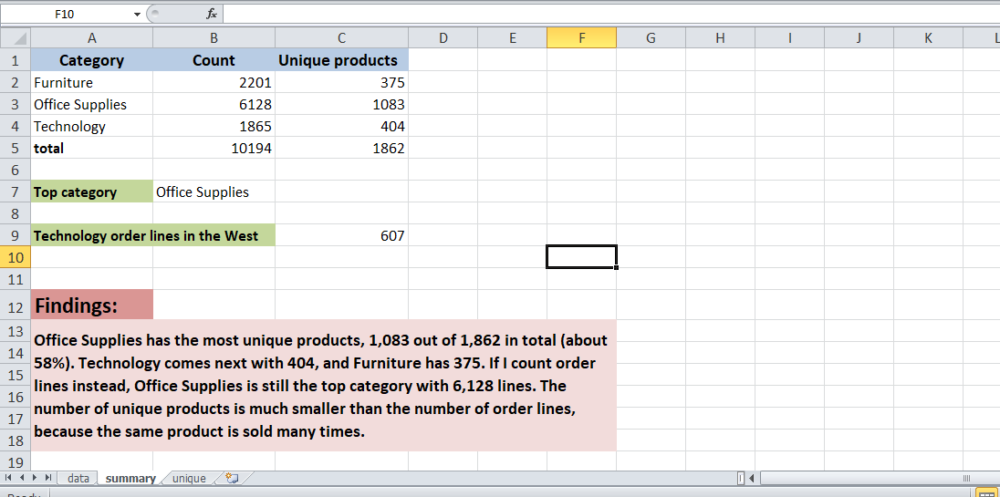

# Product Count Analysis (Superstore Dataset)

## Overview
Counted products by category in the Sample Superstore Orders data (10,194 order lines)
and found the top category, using COUNTIF and COUNTIFS in Excel.

## Workbook structure
- data: original Orders data
- unique: one row per Product ID (after Remove Duplicates)
- summary: product count table and top category

## Method
- COUNTIF: order lines per category
- Remove Duplicates on Product ID, then COUNTIF: unique products per category
- COUNTIFS: Technology order lines in the West (two conditions)
- INDEX/MATCH + MAX: top category

## Results
- Furniture: 2,201 order lines, 375 unique products
- Office Supplies: 6,128 order lines, 1,083 unique products
- Technology: 1,865 order lines, 404 unique products
- Total unique products: 1,862
- Top category: Office Supplies (58% of all unique products)

## Tools Used
Microsoft Excel (COUNTIF, COUNTIFS, Remove Duplicates, INDEX/MATCH)

## Dataset
Sample Superstore Dataset

## Screenshot

